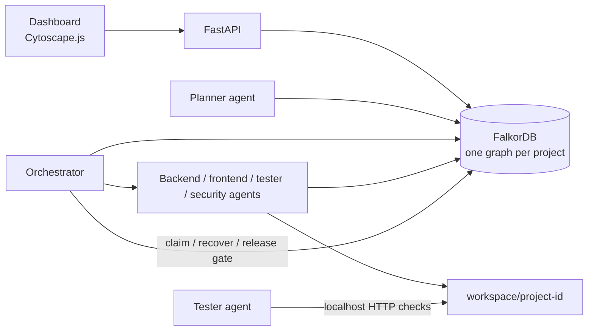

# CrewGraph

CrewGraph is a prototype for coordinating software-building agents through a shared FalkorDB knowledge graph. Each project has its own graph, where task dependencies, claims, handoffs, artifacts, bugs, approvals, and events are persisted. It runs in mock LLM mode by default, without an API key; in this mode the planner DAG and worker file contents are canned fixtures, not live model output.

Agents never call one another directly: they read and write shared project state in FalkorDB. The orchestrator uses those graph facts to decide what can run, who can claim it, what evidence downstream work receives, and whether release is allowed.

The graph scheduling, atomic claims, localhost HTTP endpoint checks, static security checks, bug/artifact links, and approval-based release gate are real application behavior. Planning and generated file contents are canned in mock mode. A real provider is available through the OpenAI Chat Completions API; its live output is not exercised by the automated suite.

To use that provider, configure your own model and key in the shell (do not commit the key). The implementation requires all three variables:

```powershell
$env:LLM_PROVIDER = "openai"
$env:LLM_MODEL = "<supported-model>"
$env:LLM_API_KEY = "<your API key>"
```

The equivalent POSIX shell settings are `export LLM_PROVIDER=openai`, `export LLM_MODEL=<supported-model>`, and `export LLM_API_KEY=<your API key>`. The default `LLM_PROVIDER=mock` does not make network calls.

## Architecture



## Why the graph is central

FalkorDB is the system of record for tenant-isolated projects. The product's scheduling, handoffs, bug evidence, approvals, and dashboard events are read from or written to each project's graph; removing FalkorDB stops those workflows.

The following are the Cypher statements used by the named functions in `app/queries.py`. All reads use `ro_query`; writes use `query`.

### Scheduling and claims

`ready_tasks(graph)` finds pending or ready tasks only when every dependency is done:

```cypher
MATCH (task:Task)
WHERE task.status IN ['pending', 'ready']
OPTIONAL MATCH (task)-[:DEPENDS_ON]->(dependency:Task)
WITH task,
     count(dependency) AS dependency_count,
     sum(CASE WHEN dependency.status = 'done' THEN 1 ELSE 0 END) AS done_count
WHERE dependency_count = done_count
RETURN task
```

`claim_task(graph, task_id, agent, lease_seconds)` uses one guarded write, so only a task still in `ready` can be claimed:

```cypher
MATCH (task:Task {id: $task_id})
WHERE task.status = 'ready'
SET task.status = 'claimed',
    task.claimed_by = $agent,
    task.lease_until = timestamp() + ($lease_seconds * 1000)
RETURN task
```

`complete_task(graph, task_id)` marks the task done, then promotes pending tasks whose dependencies are all done:

```cypher
MATCH (task:Task {id: $task_id})
SET task.status = 'done'
RETURN task
```

```cypher
MATCH (task:Task {status: 'pending'})
OPTIONAL MATCH (task)-[:DEPENDS_ON]->(dependency:Task)
WITH task,
     count(dependency) AS dependency_count,
     sum(CASE WHEN dependency.status = 'done' THEN 1 ELSE 0 END) AS done_count
WHERE dependency_count = done_count
SET task.status = 'ready'
```

### Handoffs and evidence

`handoff(...)` writes a task-to-agent handoff with its reason and timestamp:

```cypher
MATCH (task:Task {id: $task_id})
MERGE (recipient:Agent {name: $to_agent})
MERGE (task)-[handoff:HANDED_OFF_TO {from_agent: $from_agent}]->(recipient)
SET handoff.reason = $reason,
    handoff.ts = timestamp()
RETURN task
```

`handoff_context(graph, task_id)` reads the task, dependency artifacts, open bugs or vulnerabilities linked to those artifacts, and project lessons in one query. `record_artifact(...)` links an artifact to both its task and producing agent.

`record_bug(...)` merges a bug and links it to the artifact that exposed it:

```cypher
MATCH (artifact:Artifact {id: $artifact_id})
MERGE (bug:Bug {id: $bug_id})
SET bug.title = $title,
    bug.severity = $severity,
    bug.status = $status,
    bug.kind = $kind,
    bug.fix_suggestion = $fix_suggestion
FOREACH (_ IN CASE WHEN $line IS NULL THEN [] ELSE [1] END |
    SET bug.line = $line)
MERGE (bug)-[:FOUND_IN]->(artifact)
RETURN bug
```

### Release gate

`release_status(graph, project_id)` first checks that the project exists, then reads all task statuses and open bugs, and finally checks for an approved `Approval` linked from the project:

```cypher
MATCH (project:Project {id: $project_id}) RETURN project
```

```cypher
MATCH (task:Task) RETURN task
```

```cypher
MATCH (bug:Bug {status: 'open'}) RETURN bug
```

```cypher
MATCH (:Project {id: $project_id})-[:APPROVES]->
      (approval:Approval {status: 'approved'})
RETURN approval
```

`can_release(...)` is true only when all four conditions are satisfied. Only then does the orchestrator create and complete the final release task.

## Run locally

Requirements: Python 3.11 and Docker.

```powershell
docker compose up -d
python -m venv .venv
.venv\Scripts\Activate.ps1
pip install -r requirements.txt
python -m pytest -q
```

The local FalkorDB Browser is at `http://localhost:3000`. To create the two synthetic tenant graphs, run `python -m scripts.seed`.

Run the mock demo:

```powershell
python -m scripts.run_demo
python -m scripts.run_demo --auto-approve
```

The first command runs the project and stops at the approval gate. The second adds approval and runs the release task.

### Demonstrate detected flaws

The functional flaw makes the generated API accept an empty title; the tester detects the real HTTP response, and the debugger repairs it:

```powershell
python -m scripts.run_demo --flaw --auto-approve
```

The security flaw adds a synthetic fake key and wildcard CORS configuration. In PowerShell:

```powershell
$env:DEMO_FLAW = "security"
python -m scripts.run_demo --auto-approve
$env:DEMO_FLAW = "0"
```

Or on POSIX shells:

```sh
DEMO_FLAW=security python -m scripts.run_demo --auto-approve
```

All generated application HTTP checks use localhost. No real key is used by either flaw mode.

### Start the dashboard

```powershell
uvicorn app.main:app --reload
```

Open `http://localhost:8000/`. The page polls the project graph, event feed, and release status every two seconds. Use **Run demo**, **Run demo with flaw**, and **Approve** to follow the flow.

## Tests and load test

The suite contains **27 passing tests**. Integration tests use the real local FalkorDB and delete their temporary graphs; mock/unit coverage does not call a live model provider:

```powershell
python -m pytest -q
```

Run the default 20-project parallel mock load test with `python -m scripts.load_test`; `--projects` and `--workers` can change its scale. It creates separate project graphs, measures completed task throughput, and removes those temporary graphs. The latest measured run and its output are in [docs/load_test_results.md](./docs/load_test_results.md).

## Limitations

- This is a local hackathon prototype, not a production multi-user service; it has no authentication or authorization.
- The generated to-do app and its in-memory data are intentionally small and are not durable.
- The static security scanner uses a short set of pattern checks, not a comprehensive security audit.
- Background demo runs are process-local and have no persistent job status or distributed worker recovery.
- The dashboard loads its pinned Cytoscape.js build from a CDN and therefore needs browser access to that CDN.
